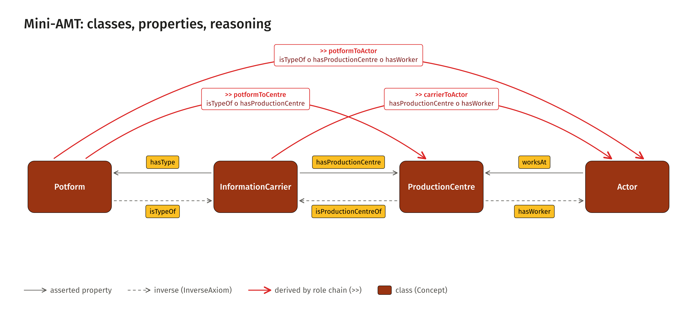

# samian-amt

A deliberately small AMT domain model for the chain

    [Potform] -- [InformationCarrier] -- [ProductionCentre] -- [Actor]

and the role-chain reasoning on top of it, documented as GitHub Pages in `docs/`.
It is about the **model and its reasoning**, with the weight rule of the source paper
and three real chains from the Samian Research data. There are no persistent IRIs yet. This repository is laid out (`main.py`, `py/`,
`ontology/`, `data/`, `docs/`) so that it can move into `samian-amt` as it is.

## The model in one table

| Layer | What | Names |
|---|---|---|
| Concepts | four classes and a helper | `Potform`, `InformationCarrier`, `ProductionCentre`, `Actor`; `Entity` is only the domain and range of `reaches` / `reachedBy` |
| Asserted roles | direction of the source data | `hasType` (IC -> Potform), `hasProductionCentre` (IC -> PC), `worksAt` (Actor -> PC) |
| Inverse roles | `amt:InverseAxiom` | `isTypeOf`, `isProductionCentreOf`, `hasWorker` |
| Derived roles (`>>`) | `amt:RoleChainAxiom` | `potformToCentre`, `carrierToActor`, `potformToActor` |
| Derived inverses (`<<`) | `amt:InverseAxiom` | `centreToPotform`, `actorToCarrier`, `actorToPotform` |
| Generic `>>` / `<<` | `amt:SubsumptionAxiom` + inverse | `reaches`, `reachedBy` |

The three rules, as role chains over the roles that point along the chain direction:

    [Potform]>>[ProductionCentre]              = isTypeOf o hasProductionCentre
    [InformationCarrier]>>[Actor]              = hasProductionCentre o hasWorker
    [Potform]>>[Actor]                         = isTypeOf o hasProductionCentre o hasWorker

Two of the three asserted roles point against the chain direction, so every rule
needs at least one inverse. `hasType` / `isTypeOf` was agreed with Allard Mees.
Every role carries a `skos:definition` and a `skos:scopeNote` in the ontology; the
documentation is generated from them.

## Weights and direction

An inverse edge carries the **same** `amt:weight` as its antecedent (the AMT
`InverseRule` copies it), because the weight is the degree of the statement and an
inverse is the same statement read from the other end. All AMT operators are
symmetric, so a derived `>>` and its `<<` carry the same degree too. Shares,
frequencies and normalised alternatives are directional and do not belong in
`amt:weight`. Details: `docs/weights.md`.

## Round trip AMT → AFE → AMT

`queries/amt-to-afe.rq` writes the hextuples of the chains as the container pattern of the AFE coin data
(a value, or a `skos:Collection` of members with `fw:hasConfidence`), `queries/afe-to-amt.rq` reads it back.
`py/step_roundtrip.py` (`python main.py --only roundtrip`) runs both and checks that subject, predicate, object,
weight and FW type of every hextuple come back unchanged, and that the reasoning on the returned statements gives the
same edges. Not carried (documented, not smuggled through): source string, method, frequency shares, attribution.
The AFE side is a rebuilt pattern with `sam:` predicates, not AFE data. Details: `docs/roundtrip.md`.

## Weights, hextuple and chains

`py/weights.py` computes the weight of a source string by the rule agreed with Allard Mees
(2026-11-04: equal share of the paper, halved by a question mark),
`amt_weight = (1 / n_possibilities) * (1/2 if "?" else 1)`, and derives the FW type
(`fw:Certainty`, `fw:Uncertainty`, `fw:Vagueness`, `fw:FuzzinessWobbliness`) from the pattern of the string
(question mark, AND, OR) for each relation. A statement then is a **hextuple** with the terms of the
[FW ontology](https://github.com/caa-datadragons/FW_Ontology): subject, predicate, object,
`fw:hasDegreeOfConnection` (the same as `amt:weight`), `fw:hasType` and `fw:hasMethod`
(`fw:EqualShareRule`); the source string is kept as `fw:TextEvidence` and linked with `fw:derivedFrom`.
`py/step_chains.py` models three chains from the Samian Research data (`data/chains-source.csv`) and runs two
models over them: M1 (this ontology) and M2 (`ontology/variant-b-derived.ttl`, carrier-centre derived
from the actor). It reads its own Turtle back and checks that every statement leads to its string. If
the AMT engine with `fw:Certainty` (0.6.0 plus the engine step S25, see `requirements.txt`) is installed, it also runs the three
models with the engine and compares every edge, type and method included.
`dist/chains-with-model.ttl` can be run with the AMT runner or loaded in the AMT Explorer.
`ontology/fw-implemented-by.ttl` is the one triple (`fw:implementedBy`) that the FW ontology still lacks.

## Run

Windows `cmd`, from the repository root:

    pip install -r requirements.txt

    python main.py

`python main.py --list` shows the steps (`weights`, `reason`, `chains`, `explorer`, `visuals`, `docs`),
`--only docs` runs one. Output goes to `dist/` (reasoning) and `docs/` (figures and
pages) and is byte-identical from run to run. `docs/` is committed because GitHub
Pages serves it; set Pages to "Deploy from a branch", folder `/docs`.

The `reason` step (toy chain) uses an independent reference reasoner (`py/reference_reasoner.py`,
about sixty lines). If the AMT engine is importable
(`pip install "amt @ git+https://github.com/alpaca-fair-framework/amt-engine.git@ce23c5c"`),
the same step also runs the engine on `dist/samian-amt-with-toy.ttl` and fails if the two disagree on
any edge or weight.

## Placeholders and proposals

* The namespace `sam:` (`http://example.org/samian-amt/`) is not a real IRI.
* The documentation links to the planned home `leiza-scit/samian-amt`
  (`REPO` in `py/docs_text.py`).
* `amt:logic` of the three role chains is `amt:ProductLogic`, as in the role-chain axioms of
  the source paper. It is a proposal; the toy weights (0.9 / 0.6 / 0.8) are arbitrary.
* `fw:implementedBy` of `fw:EqualShareRule` is not in the FW ontology yet (`ontology/fw-implemented-by.ttl`).
* Role names other than `hasType` / `isTypeOf` are proposals.
* The source model's `ActorEntity` and `Actor` are collapsed into `Actor`.

## Layout

    main.py                    orchestrator (--list, --only, --dry-run)
    requirements.txt
    CHANGELOG.md
    ontology/samian-amt.ttl      the domain model M1, no instances
    ontology/variant-b-derived.ttl   model M2: carrier-centre derived from the actor
    ontology/fw-implemented-by.ttl   the fw:implementedBy triple for fw:EqualShareRule (not read by the code)
    data/toy-chain.ttl         one abstract individual per concept
    data/chains-source.csv     source strings of the three real chains
    data/weight-cases.csv      test cases of the weight rule
    py/                        utils, weights, reference_reasoner, site_kit, docs_text, step_*
    docs/explorer/             the AMT Explorer with the three chains (page, scripts, libraries static; data/ generated)
    docs/                      GitHub Pages: stylesheet, layout and pages (generated), figures and figure pages in `visuals/`
    dist/                      reasoning output (generated, not committed)
