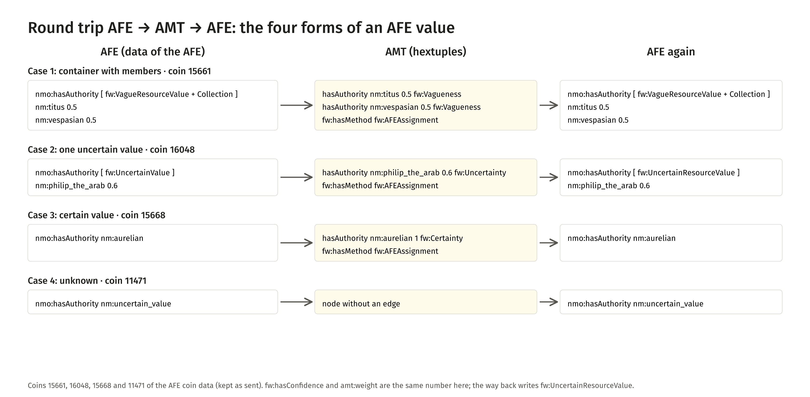
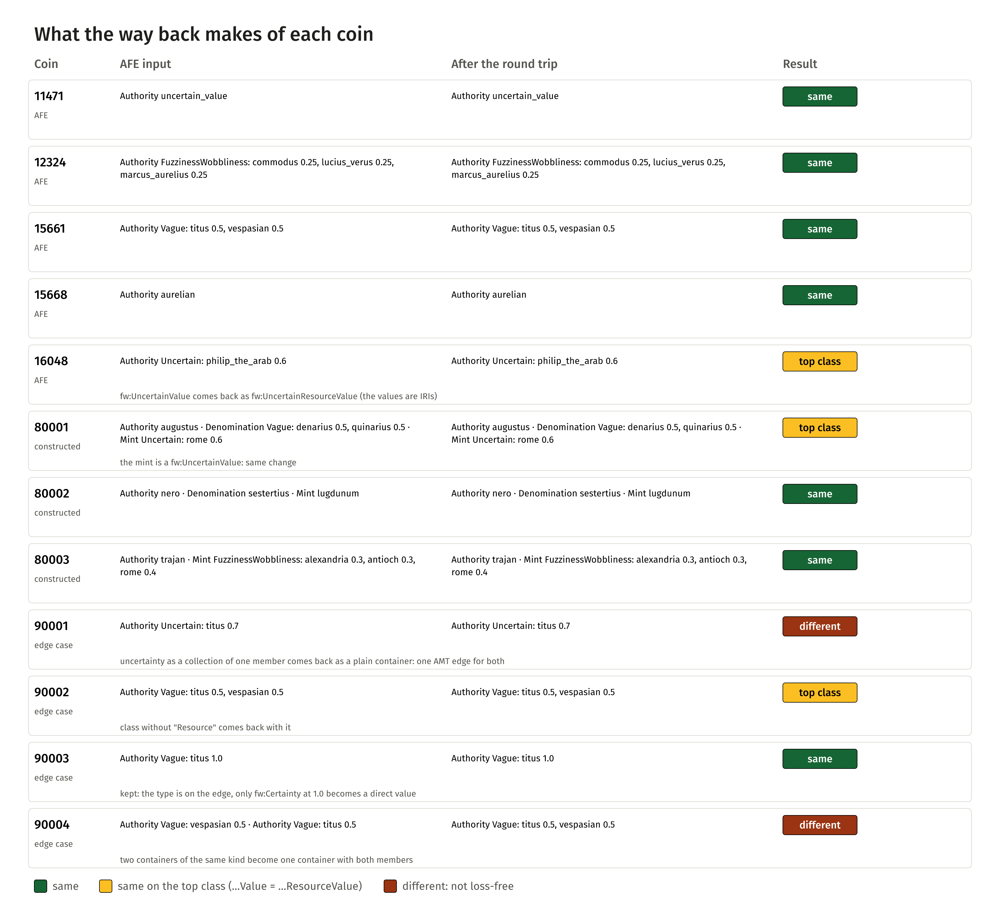

<!-- Generated by main.py (step: docs). Do not edit by hand; edit py/docs_text.py or ontology/samian-amt.ttl. -->

# Round trip: AFE → AMT → AFE

> **State of the package, version 3 (2026-11-03).** This page shows the round trip as Karsten Tolle's package describes it,
> run on his coin data. His answers to the open questions at the end are still pending; the page is updated when they arrive.

The other page, [AMT → AFE → AMT](roundtrip.html), starts with the AMT data of this repository and rebuilds an AFE pattern.
This page starts with **real AFE data**: coins of the AFE with the container pattern for Authority (the issuing power).
Two SPARQL queries turn the containers into AMT hextuples and back. The question is the same: does a vague or uncertain
statement come back as it went?

## Four forms of an AFE value

An AFE value has one of four forms. Each form has exactly one way into AMT:

| Case | AFE form | AMT |
|---|---|---|
| 1 | a container with members: `fw:VagueResourceValue` or `fw:FuzzinessWobblinessResourceValue`, also a `skos:Collection` | one hextuple per member; weight = `fw:hasConfidence` of the member; `fw:hasType` from the container class |
| 2 | one uncertain value: `fw:UncertainResourceValue` with `rdf:value` and `fw:hasConfidence` | one hextuple, `fw:Uncertainty` |
| 3 | a certain value directly on the coin | one hextuple, weight 1.0, `fw:Certainty` |
| 4 | `nm:uncertain_value`: unknown (Authority only) | the coin becomes a node without an edge |

Every hextuple gets `fw:hasMethod fw:AFEAssignment`: in the AFE a person or the system enters the confidence; it is not a
calculation rule. (`fw:EqualShareRule` belongs to the Samian source strings.) The way back reads the type from the edge and
writes the container; a coin without an edge gets `nm:uncertain_value` again.

<figure class="fig"><a href="visuals/img/afe-roundtrip-01-flow.png"></a><figcaption>Four coins of the AFE: the structure in the AFE, as hextuples, and rebuilt<a href="visuals/img/afe-roundtrip-01-flow.png">PNG</a><a href="visuals/img/afe-roundtrip-01-flow.svg">SVG</a></figcaption></figure>

## Result

Five coins of the AFE come back equal: four exactly the same, one (16048) on the **top class**. The AFE writes
`fw:UncertainValue` where the way back writes `fw:UncertainResourceValue`; the values are IRIs, so the resource class is the
fitting one, and the AFE side agreed that `…Value` and `…ResourceValue` are the same on the top level. The same holds for the
constructed coin 80001.

If the AMT engine 0.7.0 or newer is installed, the five coins also go through the engine (reasoning) before the way back, and
the result is the same.

| Coin of the AFE | After the round trip |
|---|---|
| 11471 | same |
| 12324 | same |
| 15661 | same |
| 15668 | same |
| 16048 | top class |

All coins of the test data, with the constructed ones:

<figure class="fig"><a href="visuals/img/afe-roundtrip-02-cases.png"></a><figcaption>What the way back makes of each coin<a href="visuals/img/afe-roundtrip-02-cases.png">PNG</a><a href="visuals/img/afe-roundtrip-02-cases.svg">SVG</a></figcaption></figure>

## Constructed edge cases

Four constructed coins (`data/afe/afe-edge-cases.ttl`, numbers 90001 to 90004) test the border of the pattern. They
are part of the test: the step fails if one of them behaves differently from what is written here.

| Coin | Case (memo) | AFE input | Result | Why |
|---|---|---|---|---|
| 90001 | A | uncertainty written as a collection with one member | different | AMT has one edge for it, so the way back writes a plain container: the AFE form is not recoverable |
| 90002 | B | `fw:VagueValue` (without "Resource") | same on the top class | the way back writes `fw:VagueResourceValue` |
| 90003 | C | vague with one member at confidence 1.0 | same | the type is on the edge; only `fw:Certainty` at 1.0 becomes a direct value |
| 90004 | D | two containers of the same kind on one property | different | they become one container with both members |

Coins 80001 to 80003 test `nmo:hasDenomination` and `nmo:hasMint` in the same patterns. **Their property names are assumed**
from Nomisma and the three coins are constructed; the AFE data seen so far have only `nmo:hasAuthority`.

## What is lost

* **Case A and case D.** The AFE form of an uncertainty as a one-member collection, and the split into several containers on
  one property, are not carried by the hextuples (see the table above).
* **Top class.** `…Value` becomes `…ResourceValue` (agreed as equal).
* **Container identity.** Containers are blank nodes; they come back as new blank nodes, the structure is the same.
* **Number spelling.** `0.25` and `0.250000` are the same `xsd:decimal`; the engine writes six places.
* **Source texts.** There are none in the AFE data, so nothing is lost here (unlike the Samian strings).

## Run it

```
python main.py --only afe-roundtrip
```

On Windows, in one line: `python main.py --only afe-roundtrip && type dist\afe-roundtrip-report.md`. It writes
`dist/afe-<name>-as-amt.ttl` (hextuples), `dist/afe-<name>-back.ttl` (the pattern rebuilt) and `dist/afe-roundtrip-report.md`.
The data are in `data/afe/` (5 coins of the AFE, kept as sent; 3 constructed coins with denomination and mint;
four edge cases), the queries in `queries/coins/`, the step is [`py/step_afe_roundtrip.py`](https://github.com/leiza-scit/samian-amt/blob/main/py/step_afe_roundtrip.py).
The coin data and the memo are from Karsten Tolle (AFE).

## Open points

For Karsten Tolle (memo of 2026-11-03, section 8):

1. Are `nmo:hasDenomination` and `nmo:hasMint` the property names in the AFE, with `nm:` concepts as values?
2. How are coins without `nmo:hasAuthority` marked as unknown, and is it only Authority that has `nm:uncertain_value`?
3. Is the confidence property `fw:hasConfidence` (as in the data) or `fw:hasConfidenceLevel`?
4. Which class does a certain value get when it has to sit in a container?
5. Is there a rule for the weights of a container (sum, equal share), or are they free?
6. How should other properties with only the "uncertain" flag be read?

From the other round trip, still open: may one subject have **two containers on the same predicate** (several `nmo:hasAuthority`
edges, each with its own container)? Karsten's earlier answer says: today at most one container per property, in future
several.

## The queries in full

### `queries/coins/afe-to-amt.rq`

```sparql
# AFE -> AMT (hextuples), version 3 of the AFE-AMT-AFE package, 2026-11-03; for the coin data of the AFE.
# Four cases, by the form of the AFE value:
#   1 a container with members (vague, or fuzzy / wobbly): one hextuple per member, fw:hasType from the container class
#   2 an uncertain value (container with rdf:value and fw:hasConfidence): one hextuple, fw:Uncertainty
#   3 a certain value directly on the coin: one hextuple, weight 1.0, fw:Certainty
#   4 nm:uncertain_value (unknown, nmo:hasAuthority only): the coin becomes a node without an edge
# Three properties (table VALUES at the start of each case): nmo:hasAuthority, nmo:hasDenomination, nmo:hasMint.
# The names nmo:hasDenomination and nmo:hasMint and the concepts nm:Denomination and nm:Mint are assumed from Nomisma;
# they are not in the AFE data seen so far (open question to the AFE side).
# Every edge gets fw:hasMethod fw:AFEAssignment: in the AFE a person (or the system) enters the confidence, it is
# not a calculation rule (fw:EqualShareRule belongs to the Samian strings). Classes without "Resource" are read too
# (VagueValue like VagueResourceValue). Not changed in content from the package; only these comments are in English.
PREFIX crm:  <http://www.cidoc-crm.org/cidoc-crm/>
PREFIX nm:   <http://nomisma.org/id/>
PREFIX nmo:  <http://nomisma.org/ontology#>
PREFIX rdf:  <http://www.w3.org/1999/02/22-rdf-syntax-ns#>
PREFIX rdfs: <http://www.w3.org/2000/01/rdf-schema#>
PREFIX skos: <http://www.w3.org/2004/02/skos/core#>
PREFIX xsd:  <http://www.w3.org/2001/XMLSchema#>
PREFIX afe:  <http://afe.dainst.org/coin?afeid=>
PREFIX fw:   <http://w3id.org/fw_ontology/>
PREFIX lado: <http://archaeology.link/ontology#>
PREFIX amt:  <http://academic-meta-tool.xyz/vocab#>

CONSTRUCT {
    ?coin a nmo:NumismaticObject ;
          rdfs:label ?label ;
          amt:instanceOf ?concept ;
          lado:hasAMT    ?amtNode .
    ?authNode amt:instanceOf ?objConcept ;
              rdfs:label     ?authLabel .

    ?amtNode rdf:subject   ?coin ;
             rdf:predicate ?prop ;
             rdf:object    ?authority ;
             amt:weight    ?weight ;
             fw:hasMethod  fw:AFEAssignment ;
             fw:hasType    ?fwType .          # in Fall 1 optional (unbekannte Klasse), sonst immer gebunden

    afe:Coins    a amt:Concept ; rdfs:label "afe coins" .
    ?objConcept  a amt:Concept ; rdfs:label ?objLabel .
}
WHERE {
    {
        # Fall 1: Container mit Mitgliedern (vage oder kombiniert)
        VALUES (?prop ?objConcept ?objLabel) {
            (nmo:hasAuthority    nm:Authority    "Authority")
            (nmo:hasDenomination nm:Denomination "Denomination")
            (nmo:hasMint         nm:Mint         "Mint")
        }
        ?coin a nmo:NumismaticObject ;
              ?prop ?container .
        ?container skos:member ?candidate .
        ?candidate rdf:value ?authority ;
                   fw:hasConfidence ?weight .
        OPTIONAL {
            ?container a ?cType .
            VALUES (?cType ?fwType) {
                (fw:VagueValue fw:Vagueness) (fw:VagueResourceValue fw:Vagueness)
                (fw:UncertainValue fw:Uncertainty) (fw:UncertainResourceValue fw:Uncertainty)
                (fw:FuzzinessWobblinessValue fw:FuzzinessWobbliness)
                (fw:FuzzinessWobblinessResourceValue fw:FuzzinessWobbliness)
            }
        }
        BIND(BNODE() AS ?amtNode)
        BIND(afe:Coins AS ?concept)
        BIND(?authority AS ?authNode)
    }
    UNION
    {
        # Fall 2: Unsicherer Wert, Konfidenz am Container
        VALUES (?prop ?objConcept ?objLabel) {
            (nmo:hasAuthority    nm:Authority    "Authority")
            (nmo:hasDenomination nm:Denomination "Denomination")
            (nmo:hasMint         nm:Mint         "Mint")
        }
        ?coin a nmo:NumismaticObject ;
              ?prop ?container .
        ?container rdf:value ?authority ;
                   fw:hasConfidence ?weight ;
                   a ?cType .
        VALUES (?cType ?fwType) {
            (fw:VagueValue fw:Vagueness) (fw:VagueResourceValue fw:Vagueness)
            (fw:UncertainValue fw:Uncertainty) (fw:UncertainResourceValue fw:Uncertainty)
            (fw:FuzzinessWobblinessValue fw:FuzzinessWobbliness)
            (fw:FuzzinessWobblinessResourceValue fw:FuzzinessWobbliness)
        }
        BIND(BNODE() AS ?amtNode)
        BIND(afe:Coins AS ?concept)
        BIND(?authority AS ?authNode)
    }
    UNION
    {
        # Fall 3: sicherer Wert, direkt am Objekt -> Typ fw:Certainty, Gewicht 1.0
        VALUES (?prop ?objConcept ?objLabel) {
            (nmo:hasAuthority    nm:Authority    "Authority")
            (nmo:hasDenomination nm:Denomination "Denomination")
            (nmo:hasMint         nm:Mint         "Mint")
        }
        ?coin a nmo:NumismaticObject ;
              ?prop ?authority .
        FILTER(isIRI(?authority) && ?authority != nm:uncertain_value)
        BIND("1.0"^^xsd:decimal AS ?weight)
        BIND(fw:Certainty AS ?fwType)
        BIND(BNODE() AS ?amtNode)
        BIND(afe:Coins AS ?concept)
        BIND(?authority AS ?authNode)
    }
    UNION
    {
        # Fall 4: unbekannt (nur Authority) -> Muenze ist Knoten, aber ohne Kante
        ?coin a nmo:NumismaticObject ;
              nmo:hasAuthority nm:uncertain_value .
        BIND(afe:Coins AS ?concept)
    }
    BIND(STRAFTER(STR(?coin), "?") AS ?label)
    BIND(STRAFTER(STR(?authority), "http://nomisma.org/id/") AS ?authLabel)
}
```

### `queries/coins/amt-to-afe.rq`

```sparql
# AMT -> AFE (the way back), version 3 of the AFE-AMT-AFE package, 2026-11-03.
# Reads the AMT edges with nmo:hasAuthority, nmo:hasDenomination and nmo:hasMint and builds the four AFE forms again.
# The form follows from fw:hasType and the number of edges per (coin, property, kind):
#   fw:Certainty (or no type) and weight 1.0     the property directly on the value                      (case 3)
#   uncertainty with exactly one edge            fw:UncertainResourceValue with rdf:value, fw:hasConfidence (case 2)
#   everything else (vagueness, fuzziness-wobbliness, no type with weight < 1, uncertainty with several edges)
#                                                skos:Collection with one member per edge                  (case 1)
#   coin without any edge                        nmo:hasAuthority nm:uncertain_value (Authority only)      (case 4)
# The containers get a generated IRI urn:amt-afe:container:... (SPARQL cannot share a blank node across rows);
# py/step_afe_roundtrip.py turns them into blank nodes. Not changed in content from the package.
PREFIX nm:   <http://nomisma.org/id/>
PREFIX nmo:  <http://nomisma.org/ontology#>
PREFIX rdf:  <http://www.w3.org/1999/02/22-rdf-syntax-ns#>
PREFIX skos: <http://www.w3.org/2004/02/skos/core#>
PREFIX xsd:  <http://www.w3.org/2001/XMLSchema#>
PREFIX afe:  <http://afe.dainst.org/coin?afeid=>
PREFIX fw:   <http://w3id.org/fw_ontology/>
PREFIX amt:  <http://academic-meta-tool.xyz/vocab#>

CONSTRUCT {
    ?coin a nmo:NumismaticObject .
    ?coin ?prop ?direct .
    ?coin ?prop ?container .
    ?container a ?afeClass, skos:Collection ;
               skos:member ?member .
    ?member    rdf:value ?authority ;
               fw:hasConfidence ?weight .
    ?coin ?prop ?single .
    ?single    a ?afeClass ;
               rdf:value ?authority ;
               fw:hasConfidence ?weight .
    ?coin nmo:hasAuthority ?unknown .
}
WHERE {
    {
        # Muenzen mit mindestens einer Kante
        VALUES ?prop { nmo:hasAuthority nmo:hasDenomination nmo:hasMint }
        ?edge rdf:subject ?coin ;
              rdf:predicate ?prop ;
              rdf:object ?authority ;
              amt:weight ?weight .
        OPTIONAL { ?edge fw:hasType ?t }
        # sicher: Gewicht 1 und (Typ fw:Certainty oder kein Typ); fw:Certainty mit Gewicht unter 1 gilt als Vagheit
        BIND(IF(?weight = 1 && (!BOUND(?t) || ?t = fw:Certainty), "certain",
             IF(!BOUND(?t) || ?t = fw:Certainty, fw:Vagueness, ?t)) AS ?kind)
        {
            SELECT ?coin ?prop ?kind (COUNT(?e) AS ?n) WHERE {
                VALUES ?prop { nmo:hasAuthority nmo:hasDenomination nmo:hasMint }
                ?e rdf:subject ?coin ; rdf:predicate ?prop ; amt:weight ?w .
                OPTIONAL { ?e fw:hasType ?tt }
                BIND(IF(?w = 1 && (!BOUND(?tt) || ?tt = fw:Certainty), "certain",
                     IF(!BOUND(?tt) || ?tt = fw:Certainty, fw:Vagueness, ?tt)) AS ?kind)
            } GROUP BY ?coin ?prop ?kind
        }
        BIND(IRI(CONCAT("urn:amt-afe:container:", ENCODE_FOR_URI(STR(?coin)), ":",
                        ENCODE_FOR_URI(STR(?prop)), ":", ENCODE_FOR_URI(STR(?kind)))) AS ?cid)
        BIND(IF(?kind = "certain", ?authority, ?unbound) AS ?direct)
        BIND(IF(?kind = fw:Uncertainty && ?n = 1, ?cid, ?unbound) AS ?single)
        BIND(IF(?kind != "certain" && !(?kind = fw:Uncertainty && ?n = 1), ?cid, ?unbound) AS ?container)
        BIND(IF(BOUND(?container), ?edge, ?unbound) AS ?member)
        BIND(IF(?kind = fw:Vagueness, fw:VagueResourceValue,
             IF(?kind = fw:FuzzinessWobbliness, fw:FuzzinessWobblinessResourceValue,
             IF(?kind = fw:Uncertainty, fw:UncertainResourceValue, ?unbound))) AS ?afeClass)
    }
    UNION
    {
        # Muenzen ohne jede Kante (Eigenschaft nicht angegeben: nur fuer Authority unterscheidbar, siehe Memo)
        ?coin amt:instanceOf afe:Coins .
        FILTER NOT EXISTS { ?x rdf:subject ?coin . }
        BIND(nm:uncertain_value AS ?unknown)
    }
}
```
