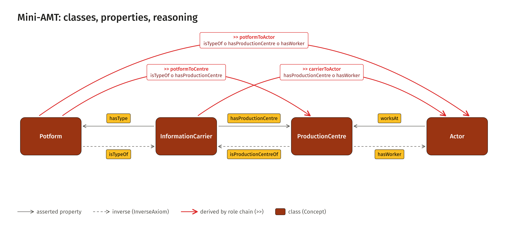

<!-- Generated by main.py (step: docs). Do not edit by hand; edit py/docs_text.py or ontology/samian-amt.ttl. -->

# samian-amt: Potform, carrier, centre, actor

> **Status: working draft.** The namespace is a placeholder. The weights follow the
> rule of the source paper (see Weights). The logic operator (product) and the role names are proposals,
> except `hasType` / `isTypeOf`, which were agreed with Allard Mees. Three real chains from the Samian Research data
> are modelled (see Chains).

A deliberately small [AMT](http://academic-meta-tool.xyz/) domain model for one chain:

    [Potform] -- [InformationCarrier] -- [ProductionCentre] -- [Actor]

The model asserts three kinds of links (a carrier has a type, a carrier is attributed to a centre,
an actor works at a centre). A role-chain reasoner derives the links that follow from them: which
potforms are associated with which centres, which carriers with which actors, which potforms with
which actors. Each derived link can be read from both ends.

<figure class="fig"><a href="visuals/img/model-01-simple.png"></a><figcaption>samian-amt, simple view<a href="visuals/img/model-01-simple.png">PNG</a><a href="visuals/img/model-01-simple.svg">SVG</a><a href="visuals/model.html">all model figures</a></figcaption></figure>

## The three rules

| Rule | Reads as |
|---|---|
| `[Potform]>>[ProductionCentre]` | a carrier of this type is attributed to that centre |
| `[InformationCarrier]>>[Actor]` | the carrier is attributed to a centre at which the actor worked |
| `[Potform]>>[Actor]` | a carrier of this type is attributed to a centre at which the actor worked |

## Pages

| Page | Content |
|---|---|
| [Model](model.html) | The concepts, the simple view and the full semantics |
| [Vocabulary](vocabulary.html) | Every concept, role and axiom: definition, what it does not say, inverse |
| [Reasoning](reasoning.html) | Why inverses are needed, the reasoning properties read from both ends, a worked chain |
| [Chains](chains.html) | Three real chains from the Samian Research data: weights, FW types, derived degrees, two models |
| [Weights](weights.html) | How the weight is computed, the hextuple, and: is `amt:weight` the same in both directions? |
| [Round trip](roundtrip.html) | AMT → AFE → AMT: the chains as the AFE container pattern and back, two SPARQL queries, what is kept and what is not |
| [Explorer](explorer/index.html) | The AMT Explorer in the browser with the three chains to choose from: graph, reasoning on and off, details, export as Turtle, Cypher, PNG and SVG |

## Files

| File | Purpose |
|---|---|
| [`ontology/samian-amt.ttl`](https://github.com/leiza-scit/samian-amt/blob/main/ontology/samian-amt.ttl) | The domain model in the AMT vocabulary: 4 concepts plus the helper concept `Entity`, 14 roles, 13 axioms |
| [`data/toy-chain.ttl`](https://github.com/leiza-scit/samian-amt/blob/main/data/toy-chain.ttl) | One abstract individual per concept, three weighted edges (no real cases) |
| [`py/weights.py`](https://github.com/leiza-scit/samian-amt/blob/main/py/weights.py) | The weight rule of the source paper, the FW type and the hextuple payload, with a lossless round-trip test |
| [`data/chains-source.csv`](https://github.com/leiza-scit/samian-amt/blob/main/data/chains-source.csv) | The source strings of the three chains, as they stand in the Samian Research data |
| [`py/reference_reasoner.py`](https://github.com/leiza-scit/samian-amt/blob/main/py/reference_reasoner.py) | Small independent reasoner used for the worked chain and as a cross-check of the AMT engine |

## Rebuild

```
python main.py
```

Writes the reasoning output (`dist/`), the figures (`docs/visuals/`) and this documentation. See `python main.py --list`.
