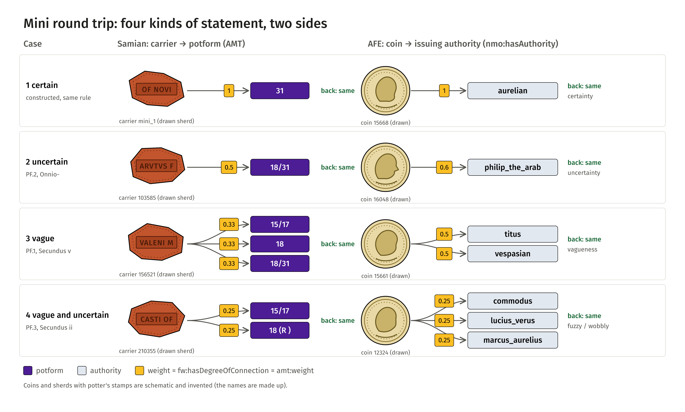
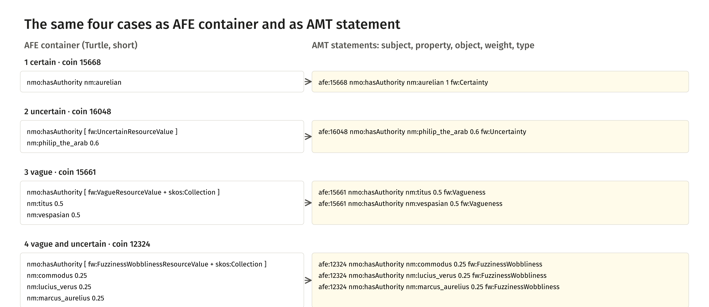
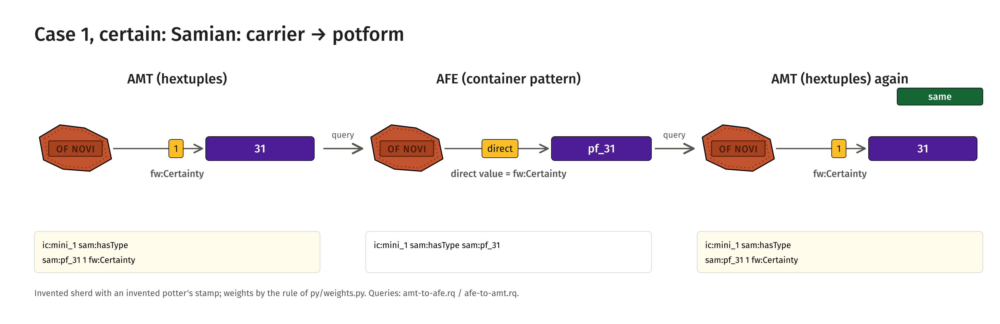
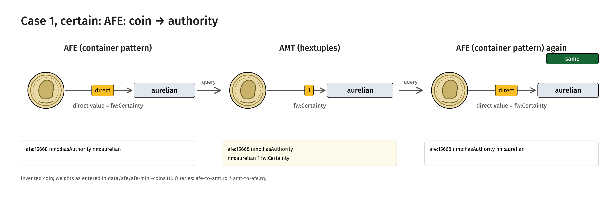
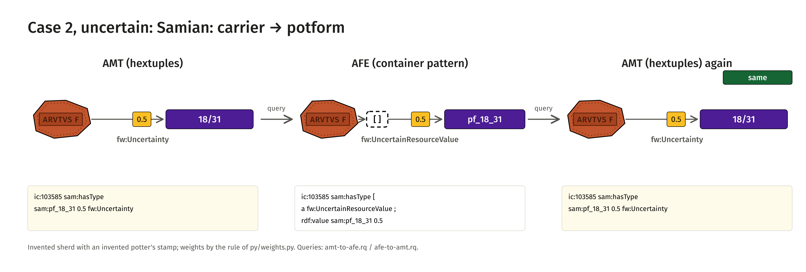
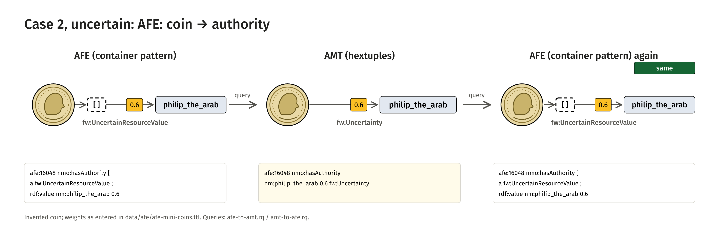
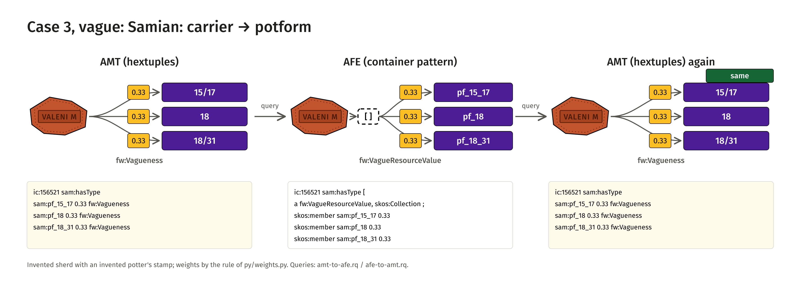
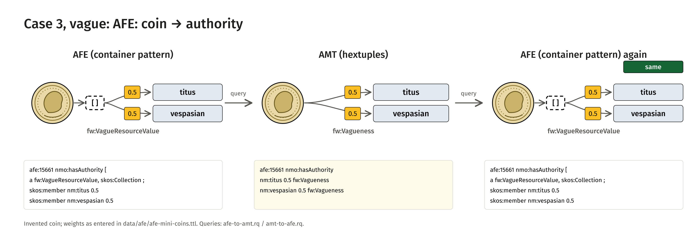
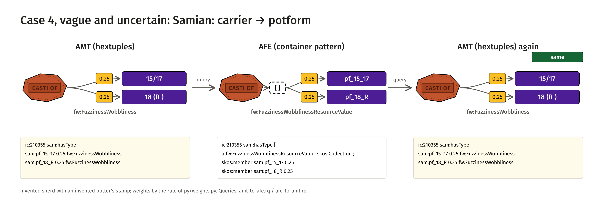
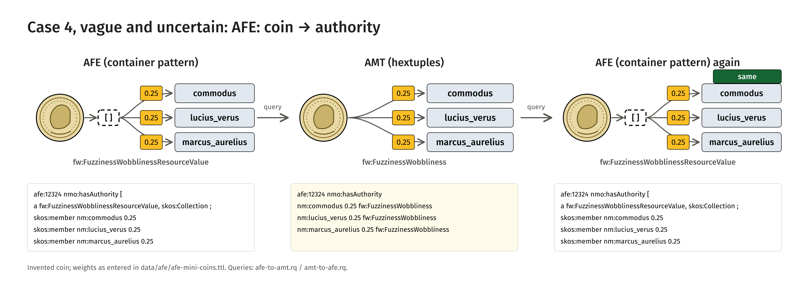

<!-- Generated by main.py (step: docs). Do not edit by hand; edit py/docs_text.py or ontology/samian-amt.ttl. -->

# Mini round trip

The smallest round trip that still says something: **one relation on each side, four kinds of statement, five parts per statement.**
On the Samian side the relation is *information carrier → potform* (cases PF.1, PF.2 and PF.3 of the [visuals](visuals/index.html), plus one certain case).
On the AFE side it is *coin → issuing authority* (`nmo:hasAuthority`, four coins of the AFE data). Both sides go AMT → AFE pattern → AMT, or AFE → AMT → AFE,
and every case has to come back the same. It follows Karsten Tolle's advice to hold back: no method, no evidence, no further properties.

## The four cases

| Case | Samian (carrier → potform) | AFE (coin → authority) | Type | Weight |
|---|---|---|---|---|
| 1 certain | `31` | coin 15668: aurelian | `fw:Certainty` | 1 |
| 2 uncertain | `18/31?` (PF.2) | coin 16048: philip_the_arab | `fw:Uncertainty` | 0.5 on the Samian side, 0.6 in the AFE data |
| 3 vague | `15/17 or 18 or 18/31` (PF.1) | coin 15661: titus or vespasian | `fw:Vagueness` | 0.33 each / 0.5 each |
| 4 vague and uncertain | `15/17 or 18 (R?)` (PF.3) | coin 12324: commodus, lucius_verus or marcus_aurelius | `fw:FuzzinessWobbliness` | 0.25 each |

The weights differ between the sides because the sides compute them by their own rule (Samian: the weight is shared equally between OR possibilities and a question mark halves it; AFE: the confidence is entered by hand).
The round trip does not care: it carries the number, it does not calculate it. The coins and sherds in the figure are schematic and invented.

<figure class="fig"><figcaption>Four kinds of statement: Samian carrier to potform, AFE coin to authority, both come back the same<a href="visuals/img/mini-01-cases.png">PNG</a><a href="visuals/img/mini-01-cases.svg">SVG</a></figcaption></figure>

## The five parts

A statement here has five parts, nothing else: **subject, property, object, weight** (`fw:hasDegreeOfConnection`, the same number as `amt:weight`) and **type** (`fw:hasType`).
The AFE form is a direct value for a certain statement, a `fw:UncertainResourceValue` with `rdf:value` and `fw:hasConfidence` for an uncertain one,
and a `skos:Collection` of members (each with its confidence) for a vague or a fuzzy/wobbly one.

<figure class="fig"><figcaption>The same four cases as AFE container and as AMT statement<a href="visuals/img/mini-02-form.png">PNG</a><a href="visuals/img/mini-02-form.svg">SVG</a></figcaption></figure>

## Each case on its own

Left to right: the first form, the second form, the first form again after the way back. Samian: AMT → AFE → AMT; coins: AFE → AMT → AFE.

### Case 1: certain

<figure class="fig"><figcaption>Case 1 (certain), Samian: AMT, AFE, AMT<a href="visuals/img/mini-case-1-sherd.png">PNG</a><a href="visuals/img/mini-case-1-sherd.svg">SVG</a></figcaption></figure>
<figure class="fig"><figcaption>Case 1 (certain), coin: AFE, AMT, AFE<a href="visuals/img/mini-case-1-coin.png">PNG</a><a href="visuals/img/mini-case-1-coin.svg">SVG</a></figcaption></figure>
### Case 2: uncertain

<figure class="fig"><figcaption>Case 2 (uncertain), Samian: AMT, AFE, AMT<a href="visuals/img/mini-case-2-sherd.png">PNG</a><a href="visuals/img/mini-case-2-sherd.svg">SVG</a></figcaption></figure>
<figure class="fig"><figcaption>Case 2 (uncertain), coin: AFE, AMT, AFE<a href="visuals/img/mini-case-2-coin.png">PNG</a><a href="visuals/img/mini-case-2-coin.svg">SVG</a></figcaption></figure>
### Case 3: vague

<figure class="fig"><figcaption>Case 3 (vague), Samian: AMT, AFE, AMT<a href="visuals/img/mini-case-3-sherd.png">PNG</a><a href="visuals/img/mini-case-3-sherd.svg">SVG</a></figcaption></figure>
<figure class="fig"><figcaption>Case 3 (vague), coin: AFE, AMT, AFE<a href="visuals/img/mini-case-3-coin.png">PNG</a><a href="visuals/img/mini-case-3-coin.svg">SVG</a></figcaption></figure>
### Case 4: vague and uncertain

<figure class="fig"><figcaption>Case 4 (vague and uncertain), Samian: AMT, AFE, AMT<a href="visuals/img/mini-case-4-sherd.png">PNG</a><a href="visuals/img/mini-case-4-sherd.svg">SVG</a></figcaption></figure>
<figure class="fig"><figcaption>Case 4 (vague and uncertain), coin: AFE, AMT, AFE<a href="visuals/img/mini-case-4-coin.png">PNG</a><a href="visuals/img/mini-case-4-coin.svg">SVG</a></figcaption></figure>

## Result

All four cases come back the same on both sides: the Samian side with 7 hextuples of 4 carriers (same statements, same nodes), the coin side
with 4 coins, also through the AMT engine (version 0.7.0 or newer; `fw:Certainty` needs it).

## Two statements on one property: what the engine does

Karsten's second answer asks for parallel statements later, each with `prov:wasAttributedTo` (an agent such as an AI model). The test file
[`data/afe/amt-parallel-statements.ttl`](https://github.com/leiza-scit/samian-amt/blob/main/data/afe/amt-parallel-statements.ttl) holds one coin and two statements
`nmo:hasAuthority nm:augustus`, weight 0.3 and 0.8, each with `fw:derivedFrom` an agent (M65, M66, `prov:SoftwareAgent`). Result with the AMT engine 0.7.0:

- the engine keeps **both edges** (weights 0.3 and 0.8) and both agent nodes;
- `prov:wasAttributedTo` on the statement itself is dropped by the engine; `fw:derivedFrom` survives and is the better carrier for the agent;
- the **way back** (`queries/coins/amt-to-afe.rq`) merges the two statements into one container, because it has nothing to group by. It would have to group by `fw:derivedFrom`.
  That is a known limit, not yet an error: the step checks it and fails as soon as the way back keeps them apart, so that this page is updated.

## Run it, step by step (Windows cmd)

Each line is one command; the lines of one step belong together and are chained with `&&`.

| Step | Command | What you see |
|---|---|---|
| 1. Set up once | `python -m venv .venv && .venv\Scripts\activate && pip install -r requirements.txt` | installs rdflib and the AMT engine `@v0.7.0` |
| 2. Run the round trip | `python main.py --only mini-roundtrip` | two lines: all four cases the same, parallel statements in the engine |
| 3. Read the verdicts | `type dist\mini-roundtrip-report.md` | table: case, Potform side, AFE side |
| 4. Potform: the hextuples (AMT) | `type dist\mini-potform-amt.ttl` | 7 statements: weight and type per statement |
| 5. Potform: the AFE pattern | `type dist\mini-potform-afe.ttl` | the same as containers (`fw:UncertainResourceValue`, `skos:Collection`) |
| 6. Potform: the way back | `type dist\mini-potform-back.ttl` | the hextuples rebuilt from the containers |
| 7. Coins: input, hextuples, way back | `type data\afe\afe-mini-coins.ttl && type dist\mini-coins-amt.ttl && type dist\mini-coins-back.ttl` | the four coins before, as hextuples, and after |
| 8. Parallel statements in the engine | `python -m amt.runner data\afe\amt-parallel-statements.ttl -o dist\parallel --no-info --strict` | two edges, weights 0.3 and 0.8 |
| 9. Everything incl. figures and pages | `python main.py && git status` | rebuilds `docs/`; a second run changes nothing |

Steps 4 to 6 and 7 are compared by the step itself as graphs (same statements, same nodes), not as text: the order of lines and blank-node names may differ.
The step writes `dist/mini-potform-*.ttl`, `dist/mini-coins-*.ttl` and `dist/mini-roundtrip-report.md`. Step: [`py/step_mini_roundtrip.py`](https://github.com/leiza-scit/samian-amt/blob/main/py/step_mini_roundtrip.py),
coins: `data/afe/afe-mini-coins.ttl`. The queries are those of the [AMT → AFE → AMT](roundtrip.html) and [AFE → AMT → AFE](afe-roundtrip.html) pages.

## Open points

- Images of the coins, with licence: asked of Karsten.
- Will every container always have a model or agent as provenance? Asked of Karsten; decides whether `fw:derivedFrom` becomes the grouping key.
- Several emperors by one model: two containers or one collection? Asked of Karsten.
- The potform entity of case 4 is written `18 (R )` by the weight rule (a quirk of the source string, kept as it is).
