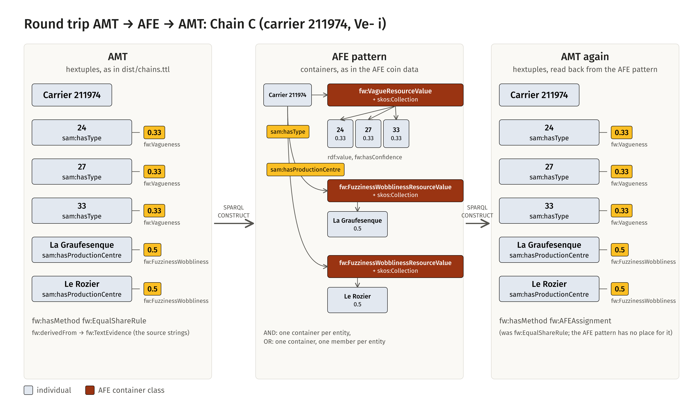
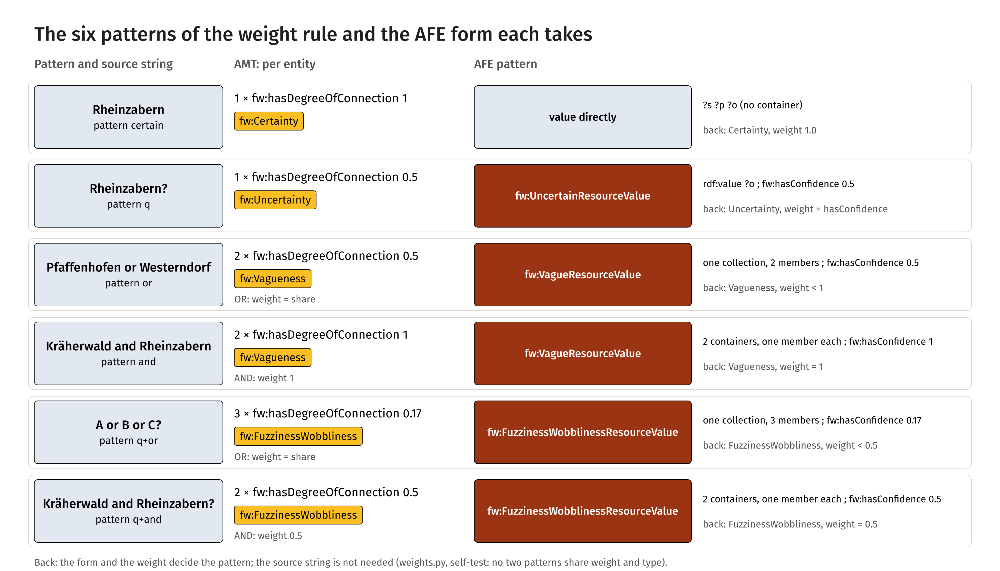
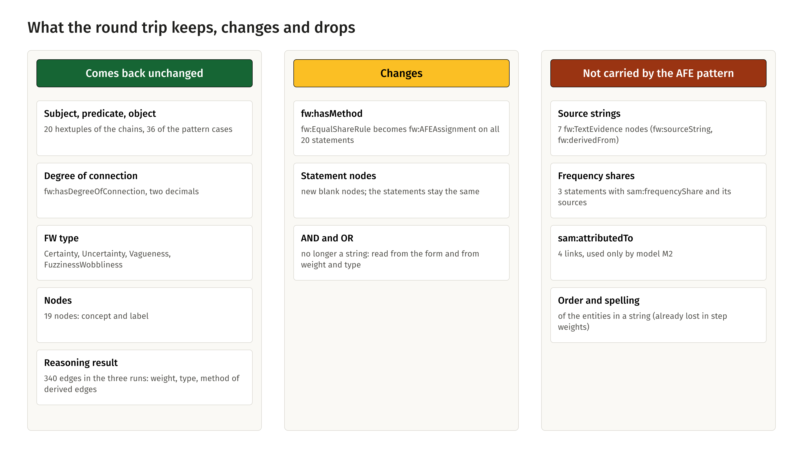

<!-- Generated by main.py (step: docs). Do not edit by hand; edit py/docs_text.py or ontology/samian-amt.ttl. -->

# Round trip: AMT → AFE → AMT

> **Work in progress.** This page is not linked from the navigation for now; the [mini round trip](mini-roundtrip.html) comes first and the larger round trips follow step by step.

The AFE coin data and the AMT meet in the same question: how is a vague or uncertain statement written down?
AFE answers with containers (a value and a confidence), AMT with a hextuple (a weight and an FW type). Karsten Tolle's
round trip goes **AFE → AMT → AFE** (see [AFE → AMT → AFE](afe-roundtrip.html)). This page shows the other direction, **AMT → AFE → AMT**: the three chains of this
repository are written as the AFE container pattern with two SPARQL queries, read back with a third, and compared with
what they started as.

> **What the AFE side is.** The AFE coin data know coins, mints and denominations, not potforms or production centres.
> The AFE side of this round trip is therefore a *rebuilt pattern*: the container classes and properties of the AFE
> (`fw:VagueResourceValue`, `fw:UncertainResourceValue`, `fw:FuzzinessWobblinessResourceValue`, `skos:Collection`,
> `skos:member`, `rdf:value`, `fw:hasConfidence`) with the `sam:` roles as predicates. It is not AFE data.

## The idea in one picture

Chain C (carrier 211974, potter Ve- i) has an OR of three forms and an AND of two centres with a question mark. The
first query turns the six hextuples on the left into the containers in the middle; the second turns the containers
into hextuples again (right).

<figure class="fig"><a href="visuals/img/roundtrip-01-flow.png"></a><figcaption>Chain C as hextuples, as AFE pattern, and as hextuples again<a href="visuals/img/roundtrip-01-flow.png">PNG</a><a href="visuals/img/roundtrip-01-flow.svg">SVG</a></figcaption></figure>

## How it works

Two SPARQL `CONSTRUCT` queries, no code in between except the step that runs them and compares:

| File | Direction |
|---|---|
| [`queries/amt-to-afe.rq`](https://github.com/leiza-scit/samian-amt/blob/main/queries/amt-to-afe.rq) | hextuples → AFE container pattern |
| [`queries/afe-to-amt.rq`](https://github.com/leiza-scit/samian-amt/blob/main/queries/afe-to-amt.rq) | AFE container pattern → hextuples |
| [`py/step_roundtrip.py`](https://github.com/leiza-scit/samian-amt/blob/main/py/step_roundtrip.py) | runs both, writes the files, compares, repeats the reasoning |

The form follows from `fw:hasType` and the weight alone. The source string is not needed (AFE has none).

| FW type and weight | Pattern | AFE form |
|---|---|---|
| `fw:Certainty` | certain | the value directly on the subject |
| `fw:Uncertainty` | `A?` | one `fw:UncertainResourceValue` with `rdf:value` and `fw:hasConfidence` |
| `fw:Vagueness`, weight 1 | `A and B` | **one container per entity** (`fw:VagueResourceValue`, one member, confidence 1) |
| `fw:Vagueness`, weight below 1 | `A or B` | **one container** with a member per entity, each with its share |
| `fw:FuzzinessWobbliness`, weight 0.5 | `A and B?` | one container per entity (`fw:FuzzinessWobblinessResourceValue`, confidence 0.5) |
| `fw:FuzzinessWobbliness`, weight below 0.5 | `A or B?` | one container with a member per entity |

For a known number of edges, weight and type separate the four patterns (`py/weights.py`, self-test), so reading
AND and OR back from them is exact for statements made by the rule.

<figure class="fig"><a href="visuals/img/roundtrip-02-patterns.png"></a><figcaption>The six patterns of the weight rule and the AFE form each takes<a href="visuals/img/roundtrip-02-patterns.png">PNG</a><a href="visuals/img/roundtrip-02-patterns.svg">SVG</a></figcaption></figure>

SPARQL cannot share a blank node between result rows, so the first query gives every container a generated IRI
(`urn:amt-afe:container:...`); the step turns these into blank nodes before it writes `dist/chains-afe.ttl`, and the second
query reads that file. The AFE form of carrier 211974 as written:

```turtle
@prefix fw: <http://w3id.org/fw_ontology/> .
@prefix rdf: <http://www.w3.org/1999/02/22-rdf-syntax-ns#> .
@prefix rdfs: <http://www.w3.org/2000/01/rdf-schema#> .
@prefix sam: <http://example.org/samian-amt/> .
@prefix skos: <http://www.w3.org/2004/02/skos/core#> .
@prefix xsd: <http://www.w3.org/2001/XMLSchema#> .

sam:ic_211974 a sam:InformationCarrier ;
    rdfs:label "Carrier 211974" ;
    sam:hasProductionCentre [ a fw:FuzzinessWobblinessResourceValue,
                skos:Collection ;
            skos:member [ fw:hasConfidence 0.5 ;
                    rdf:value sam:pc_la_graufesenque ] ],
        [ a fw:FuzzinessWobblinessResourceValue,
                skos:Collection ;
            skos:member [ fw:hasConfidence 0.5 ;
                    rdf:value sam:pc_le_rozier ] ] ;
    sam:hasType [ a fw:VagueResourceValue,
                skos:Collection ;
            skos:member [ fw:hasConfidence 0.33 ;
                    rdf:value sam:pf_24 ],
                [ fw:hasConfidence 0.33 ;
                    rdf:value sam:pf_27 ],
                [ fw:hasConfidence 0.33 ;
                    rdf:value sam:pf_33 ] ] .
```

The chains use these AFE forms: 

| Form | Count |
|---|---|
| FuzzinessWobblinessResourceValue (collection) | 4 |
| UncertainResourceValue (one value) | 3 |
| VagueResourceValue (collection) | 9 |

## SPARQL CONSTRUCT, step by step

A `SELECT` query returns a table. A `CONSTRUCT` query returns a **graph**: it has a *template* (the triples to write) and
a `WHERE` pattern (what to look for). For every way the pattern matches, the variables are filled into the template and
the triples are added to the result. A triple whose variables are not all bound is skipped. That is the whole mechanism,
and it is why one query can write several shapes at once: a variable that stays unbound in one branch simply drops that
part of the template.

On the way back the pattern finds, for carrier 211974 and the collection of potforms and the two single-member containers
of the centres, these rows (`?container` is a blank node of the AFE graph, shown as `_:c1` to `_:c3`):

| ?p | ?container | ?cType | ?o | ?w |
|---|---|---|---|---|
| `sam:hasProductionCentre` | `_:c1` | `fw:FuzzinessWobblinessResourceValue` | `sam:pc_la_graufesenque` | 0.5 |
| `sam:hasProductionCentre` | `_:c2` | `fw:FuzzinessWobblinessResourceValue` | `sam:pc_le_rozier` | 0.5 |
| `sam:hasType` | `_:c3` | `fw:VagueResourceValue` | `sam:pf_24` | 0.33 |
| `sam:hasType` | `_:c3` | `fw:VagueResourceValue` | `sam:pf_27` | 0.33 |
| `sam:hasType` | `_:c3` | `fw:VagueResourceValue` | `sam:pf_33` | 0.33 |

Each row fills the template once, and `VALUES` has turned the container class into the FW type; `BNODE()` made a new
statement node for each row. This is what the way back writes for the carrier:

| ?s | ?p | ?o | fw:hasDegreeOfConnection | fw:hasType | fw:hasMethod |
|---|---|---|---|---|---|
| `sam:ic_211974` | `sam:hasProductionCentre` | `sam:pc_la_graufesenque` | 0.5 | `fw:FuzzinessWobbliness` | `fw:AFEAssignment` |
| `sam:ic_211974` | `sam:hasProductionCentre` | `sam:pc_le_rozier` | 0.5 | `fw:FuzzinessWobbliness` | `fw:AFEAssignment` |
| `sam:ic_211974` | `sam:hasType` | `sam:pf_24` | 0.33 | `fw:Vagueness` | `fw:AFEAssignment` |
| `sam:ic_211974` | `sam:hasType` | `sam:pf_27` | 0.33 | `fw:Vagueness` | `fw:AFEAssignment` |
| `sam:ic_211974` | `sam:hasType` | `sam:pf_33` | 0.33 | `fw:Vagueness` | `fw:AFEAssignment` |

Four details of the two queries are worth knowing:

* **`UNION` branches.** The first query has one branch for the nodes and one for the statements; the second has one branch
  for each AFE form (collection, one value, direct value) and one for the nodes. Each branch binds only the variables its form
  needs.
* **The unbound-variable trick.** `BIND(IF(?kind = "direct", ?o, ?unbound) AS ?direct)` binds `?direct` only when the statement is
  certain. `?unbound` is never bound, so the `IF` yields an error and `BIND` leaves `?direct` unbound in all other cases; the
  template line `?s ?p ?direct` then writes nothing for them.
* **Generated IRIs.** SPARQL cannot hand one blank node to several result rows, but an OR container needs to be *one* node
  with several members. The first query therefore builds an IRI from subject, predicate (and object for AND), so that all rows
  of one OR reach the same container; the step turns these IRIs into blank nodes afterwards. In the second query
  `BIND(BNODE() AS ?edge)` gives every row its own statement node, which is what a reified statement needs.
* **A lookup table.** `VALUES (?cType ?fwType) { ... }` maps the AFE container class to the FW type, so the type is
  data, not code.

The queries are given in full at the end of this page.

## What is checked

1. **Statements.** Subject, predicate, object, weight and FW type of every hextuple, and the concept and label of
   every node, must come back unchanged: **20** hextuples and **19** nodes of the three chains,
   and **36** hextuples of the 18 cases of `data/weight-cases.csv`, which cover all six
   patterns.
2. **Reasoning.** The three runs (M1 product, M1 Goedel, M2 product) on the returned statements must give the same
   **340** edges as on the originals, with the same weight, type and, for derived edges, method. If the
   AMT engine is installed, it repeats the runs on the returned graph and must agree with the reference reasoner, and the
   returned graph must conform to the engine's SHACL shapes.

<figure class="fig"><a href="visuals/img/roundtrip-03-balance.png"></a><figcaption>What the round trip keeps, changes and drops<a href="visuals/img/roundtrip-03-balance.png">PNG</a><a href="visuals/img/roundtrip-03-balance.svg">SVG</a></figcaption></figure>

## What is lost

The AFE pattern has no place for the source string, the method of the weight, the observed frequency shares or the
attribution of model M2. They are **documented, not carried**: the round trip does not smuggle them through, and the test
says exactly what differs. `fw:hasMethod` comes back as `fw:AFEAssignment`, because that is what the weight now is: a value
that was assigned on the AFE side.

Counted on the chains: 7 source strings (`fw:TextEvidence`), 3 statements with frequency shares,
4 `sam:attributedTo` links.

## Run it

```
python main.py --only roundtrip
```

On Windows, with the environment of the repository, in one line: `python main.py --only roundtrip && type dist\roundtrip-report.md`.
It writes `dist/chains-afe.ttl` (the AFE pattern), `dist/chains-back.ttl` (hextuples again),
`dist/chains-back-with-model.ttl` (with the ontology, for the engine and the runner), `dist/patterns-afe.ttl`,
`dist/patterns-back.ttl` and `dist/roundtrip-report.md`. The step fails if anything on the lists above differs.

## Open points

These points are for Karsten Tolle and Allard Mees; the repository works either way.

1. Is it legal in AFE to have **two containers on the same predicate** of one subject (the AND pattern)? If not, AND needs a
   different form, for example one container with a member per entity and a marker.
2. Does an FW container have to sum its confidences to 0.5, or is a confidence per member of 0.5 (AND with `?`) fine?
3. Should AND be visible in AFE other than through weight and type?

## The queries in full

### `queries/amt-to-afe.rq`

```sparql
# samian-amt: AMT -> AFE pattern (the way out of the round trip AMT -> AFE -> AMT).
#
# Reads hextuples (rdf:subject, rdf:predicate, rdf:object, fw:hasDegreeOfConnection, fw:hasType) and builds the container
# pattern of the AFE coin data: a value is either direct (certain), a container with one value and a confidence
# (uncertain), or a skos:Collection of members, each with a value and a confidence (vague, fuzzy / wobbly).
# The AFE predicates are the AMT roles themselves (sam:hasType, sam:hasProductionCentre, sam:worksAt).
#
# The form follows from fw:hasType and the weight alone; the source string is not needed (AFE has none):
#   fw:Certainty                               the value directly on the subject
#   fw:Uncertainty                             fw:UncertainResourceValue with rdf:value and fw:hasConfidence
#   fw:Vagueness, weight 1                     AND: one container per entity (fw:VagueResourceValue, one member, 1.0)
#   fw:FuzzinessWobbliness, weight 0.5         AND with ?: one container per entity (fw:FuzzinessWobblinessResourceValue, 0.5)
#   fw:Vagueness, weight < 1                   OR: one container with a member per entity (fw:VagueResourceValue)
#   fw:FuzzinessWobbliness, weight < 0.5       OR with ?: one container with a member per entity
# For a known number of edges, weight and type separate the four patterns (see py/weights.py, selftest), so this
# reading is exact for statements made by the rule of the source paper (with the halving of the question mark).
#
# Containers get a generated IRI (urn:amt-afe:container:...) because SPARQL cannot share a blank node between rows;
# py/step_roundtrip.py turns them into blank nodes. fw:hasMethod, fw:derivedFrom and the frequency shares have no
# place in the AFE pattern and are left out.
PREFIX amt:  <http://academic-meta-tool.xyz/vocab#>
PREFIX fw:   <http://w3id.org/fw_ontology/>
PREFIX rdf:  <http://www.w3.org/1999/02/22-rdf-syntax-ns#>
PREFIX rdfs: <http://www.w3.org/2000/01/rdf-schema#>
PREFIX skos: <http://www.w3.org/2004/02/skos/core#>

CONSTRUCT {
    ?node a ?concept ;
          rdfs:label ?label .
    ?s ?p ?direct .
    ?s ?p ?single .
    ?single    a ?afeClass ;
               rdf:value ?o ;
               fw:hasConfidence ?w .
    ?s ?p ?container .
    ?container a ?afeClass , skos:Collection ;
               skos:member ?member .
    ?member    rdf:value ?o ;
               fw:hasConfidence ?w .
}
WHERE {
    {
        ?node amt:instanceOf ?concept ;
              rdfs:label ?label .
    }
    UNION
    {
        ?e rdf:subject ?s ;
           rdf:predicate ?p ;
           rdf:object ?o ;
           fw:hasDegreeOfConnection ?w .
        OPTIONAL { ?e fw:hasType ?t }
        BIND(COALESCE(?t, fw:Vagueness) AS ?type)
        # AND: every entity holds in full (weight 1, or 0.5 with a question mark); OR shares the weight
        BIND((?type = fw:Vagueness && ?w = 1) || (?type = fw:FuzzinessWobbliness && ?w = 0.5) AS ?isAnd)
        BIND(IF(?type = fw:Certainty, "direct",
             IF(?type = fw:Uncertainty, "single",
             IF(?isAnd, "and", "or"))) AS ?kind)
        BIND(CONCAT(ENCODE_FOR_URI(STR(?s)), ":", ENCODE_FOR_URI(STR(?p))) AS ?key)
        BIND(CONCAT("urn:amt-afe:container:", ?key, ":", ENCODE_FOR_URI(STR(?o))) AS ?perEntity)
        BIND(CONCAT("urn:amt-afe:container:", ?key) AS ?shared)
        BIND(IF(?kind = "direct", ?o, ?unbound) AS ?direct)
        BIND(IF(?kind = "single", IRI(?perEntity), ?unbound) AS ?single)
        BIND(IF(?kind = "and", IRI(?perEntity), IF(?kind = "or", IRI(?shared), ?unbound)) AS ?container)
        BIND(IF(BOUND(?container), IRI(CONCAT("urn:amt-afe:member:", ?key, ":", ENCODE_FOR_URI(STR(?o)))), ?unbound) AS ?member)
        BIND(IF(?type = fw:Vagueness, fw:VagueResourceValue,
             IF(?type = fw:FuzzinessWobbliness, fw:FuzzinessWobblinessResourceValue,
             IF(?type = fw:Uncertainty, fw:UncertainResourceValue, ?unbound))) AS ?afeClass)
    }
}
```

### `queries/afe-to-amt.rq`

```sparql
# samian-amt: AFE pattern -> AMT (the way back of the round trip AMT -> AFE -> AMT).
#
# Reads the container pattern of the AFE coin data on the samian-amt roles and builds hextuples again. Compared with
# the AFE -> AMT query for coins (AFE-AMT-AFE package, version 3) the properties are sam:hasType, sam:hasProductionCentre
# and sam:worksAt, the nodes carry the samian-amt concepts, and the degree is written as fw:hasDegreeOfConnection
# (the same as amt:weight; the AMT engine reads either).
#   direct value              fw:Certainty, 1.0
#   container, one value      the type of the container class, the confidence as degree
#   skos:Collection           one hextuple per member, the type of the container class
# fw:hasMethod is fw:AFEAssignment: AFE says that a value and a confidence were assigned, not how (decided with the AFE
# side on 2026-11-03). The source string is not in AFE, so there is no fw:derivedFrom.
PREFIX amt:  <http://academic-meta-tool.xyz/vocab#>
PREFIX fw:   <http://w3id.org/fw_ontology/>
PREFIX rdf:  <http://www.w3.org/1999/02/22-rdf-syntax-ns#>
PREFIX rdfs: <http://www.w3.org/2000/01/rdf-schema#>
PREFIX skos: <http://www.w3.org/2004/02/skos/core#>
PREFIX sam:  <http://example.org/samian-amt/>

CONSTRUCT {
    ?node amt:instanceOf ?concept ;
          rdfs:label ?label .
    ?edge rdf:subject   ?s ;
          rdf:predicate ?p ;
          rdf:object    ?o ;
          fw:hasDegreeOfConnection ?w ;
          fw:hasType    ?fwType ;
          fw:hasMethod  fw:AFEAssignment .
}
WHERE {
    {
        VALUES ?concept { sam:Potform sam:InformationCarrier sam:ProductionCentre sam:Actor }
        ?node a ?concept ;
              rdfs:label ?label .
    }
    UNION
    {
        # a collection: one hextuple per member
        VALUES ?p { sam:hasType sam:hasProductionCentre sam:worksAt }
        ?s ?p ?container .
        ?container skos:member ?member ;
                   a ?cType .
        ?member rdf:value ?o ;
                fw:hasConfidence ?w .
        VALUES (?cType ?fwType) {
            (fw:VagueValue fw:Vagueness) (fw:VagueResourceValue fw:Vagueness)
            (fw:UncertainValue fw:Uncertainty) (fw:UncertainResourceValue fw:Uncertainty)
            (fw:FuzzinessWobblinessValue fw:FuzzinessWobbliness) (fw:FuzzinessWobblinessResourceValue fw:FuzzinessWobbliness)
        }
        BIND(BNODE() AS ?edge)
    }
    UNION
    {
        # a container with one value and its confidence
        VALUES ?p { sam:hasType sam:hasProductionCentre sam:worksAt }
        ?s ?p ?container .
        ?container rdf:value ?o ;
                   fw:hasConfidence ?w ;
                   a ?cType .
        VALUES (?cType ?fwType) {
            (fw:VagueValue fw:Vagueness) (fw:VagueResourceValue fw:Vagueness)
            (fw:UncertainValue fw:Uncertainty) (fw:UncertainResourceValue fw:Uncertainty)
            (fw:FuzzinessWobblinessValue fw:FuzzinessWobbliness) (fw:FuzzinessWobblinessResourceValue fw:FuzzinessWobbliness)
        }
        BIND(BNODE() AS ?edge)
    }
    UNION
    {
        # a certain value, directly on the subject
        VALUES ?p { sam:hasType sam:hasProductionCentre sam:worksAt }
        ?s ?p ?o .
        FILTER(isIRI(?o))
        BIND("1.0"^^<http://www.w3.org/2001/XMLSchema#decimal> AS ?w)
        BIND(fw:Certainty AS ?fwType)
        BIND(BNODE() AS ?edge)
    }
}
```
